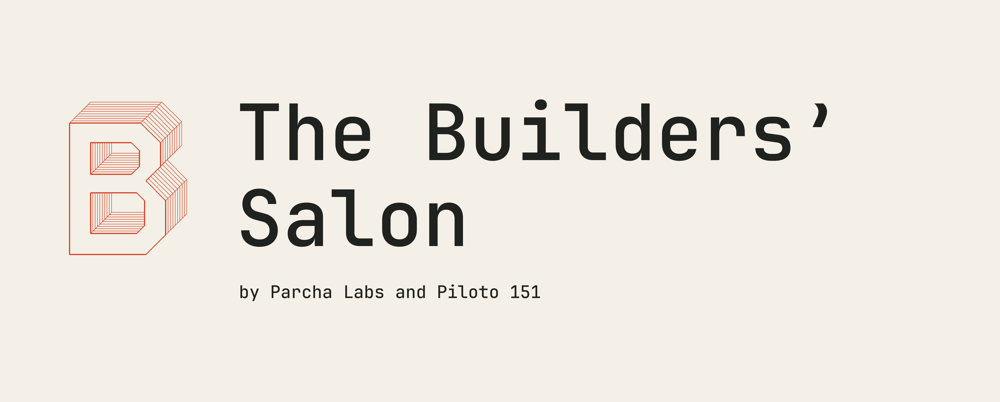
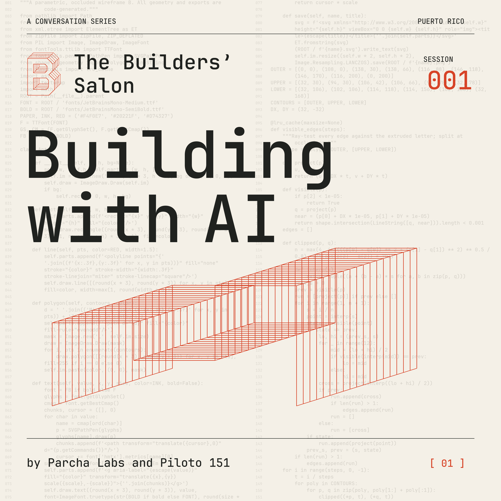

# The Builders’ Salon

Conversations about AI, from Puerto Rico. By **Parcha Labs and Piloto 151**.



We're open-sourcing our events: the code, the artwork, and the materials we create along the way. This repository starts with the series identity and the complete artwork generator for our first session.

## Events

| Session | Theme | Source and materials |
| --- | --- | --- |
| 001 | **Building with AI** | [Event folder](events/001-building-with-ai/) · [Generator](events/001-building-with-ai/artwork/generate.py) · [Flyer PNG](events/001-building-with-ai/assets/flyer.png) · [Flyer SVG](events/001-building-with-ai/assets/flyer.svg) |



## What's here

```text
brand/
  assets/                         Series logos and B marks, SVG + PNG
  fonts/                          JetBrains Mono + its original license
events/
  001-building-with-ai/
    event.json                    Session details
    artwork/                      Generator + original code-background snapshot
    assets/                       Ready-to-use flyer, SVG + PNG
scripts/
  verify_assets.py                Fresh-build and asset checks
```

Each event gets a numbered folder so its code and materials remain together as the series grows. Shared identity assets live in `brand/`.

## Build the artwork

Use **Python 3.12**. The fonts are included; the generator makes no network requests.

```sh
python3.12 -m venv .venv
source .venv/bin/activate
python -m pip install -r requirements.txt
make build
make check
```

Without Make:

```sh
python events/001-building-with-ai/artwork/generate.py
python scripts/verify_assets.py
```

The build writes the shared identity to `brand/assets/` and the first flyer to `events/001-building-with-ai/assets/`. SVGs contain outlined typography, so opening them does not require installed fonts. PNGs are exported at 2× the SVG dimensions.

To experiment without overwriting the checked-in artwork:

```sh
python events/001-building-with-ai/artwork/generate.py --output-dir build/experiment
```

`make check` rebuilds in a temporary directory, verifies the SVGs match the checked-in artwork, and checks PNG sizes, transparency, and required attribution. A [GitHub Actions workflow template](ci/artwork.yml) runs the same checks; see [ci/README.md](ci/README.md) to enable it.

## Contribute

See [CONTRIBUTING.md](CONTRIBUTING.md) for adding an event, sharing materials, or changing the artwork.

## License

Our code, documentation, and generated artwork are available under the [MIT License](LICENSE). JetBrains Mono is distributed separately under the [SIL Open Font License 1.1](brand/fonts/OFL.txt). See [brand/fonts/README.md](brand/fonts/README.md) for attribution.
