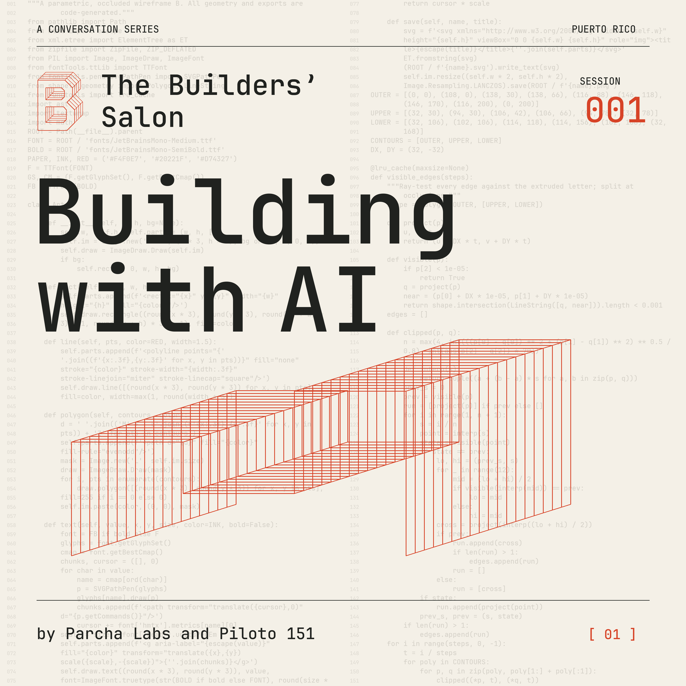

# 001 — Building with AI

The first session of **The Builders’ Salon**, a conversation series in Puerto Rico by **Parcha Labs and Piloto 151**.



## Files

| File | What it contains |
| --- | --- |
| [event.json](event.json) | Session number, theme, series, hosts, and location |
| [artwork/generate.py](artwork/generate.py) | Python generator for the flyer and initial series identity |
| [artwork/background-source.py.txt](artwork/background-source.py.txt) | The original generator, captured as the flyer’s source-code texture |
| [assets/flyer.svg](assets/flyer.svg) | Editable vector flyer; 1200 × 1200; type outlined |
| [assets/flyer.png](assets/flyer.png) | Ready-to-share flyer; 2400 × 2400 |

## Rebuild

After following the setup in the [root README](../../README.md), run from the repository root:

```sh
python events/001-building-with-ai/artwork/generate.py
python scripts/verify_assets.py
```

To keep an experiment separate from the published assets:

```sh
python events/001-building-with-ai/artwork/generate.py --output-dir build/event-001
```

## How the artwork works

The B starts as three polygon contours: its silhouette and two counters. Cross-sections are projected along a fixed extrusion. Ray tests remove hidden edges so the mark stays readable. The larger architectural drawing repeats a stepped profile along a second fixed vector.

All lettering uses the included JetBrains Mono fonts. SVG lettering is converted to paths. PNGs are rasterized directly from the same drawing operations, at 3× resolution and downsampled to 2×.

The faint, full-background code is the actual original generator. Its source is stored separately as `background-source.py.txt` so formatting or reorganizing the current generator doesn't silently change the approved texture. It is treated as text, never executed by the build.

The flyer includes the theme, hosts, and Puerto Rico. A date, venue, speaker list, and registration link have not been added. Add those here when confirmed; this folder can also grow to include demos, slides, notes, and recordings as they become available.
